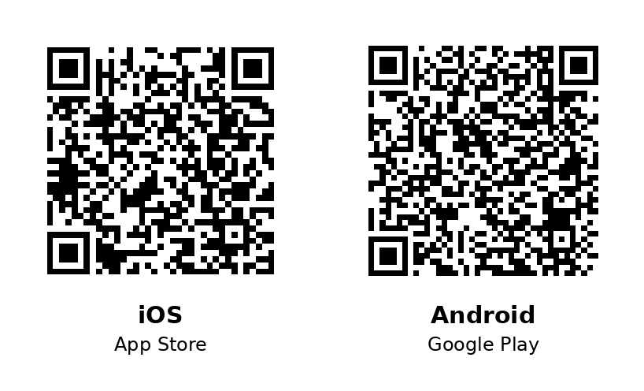
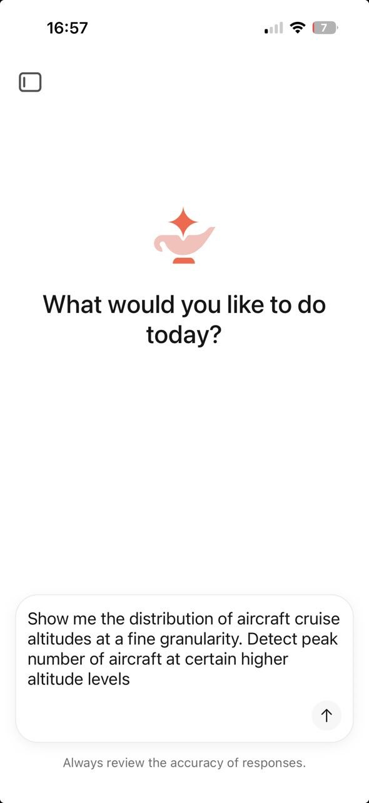
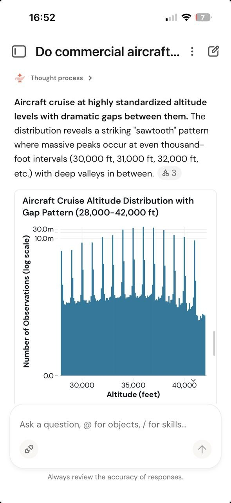

# 6. Databricks Genie One on mobile

So far, all the analysis ran at a desk, but data questions come up away from it too. The **Databricks Genie mobile app** puts Genie One on your phone: ask data questions in natural language, view and interact with dashboards, and run Databricks Apps from iOS or Android, away from your laptop.

The mobile app works alongside the Genie One web experience and respects the same Unity Catalog governance and workspace entitlements. In this step you install it, then run a query against the same `marketplace.opensky.state_vectors` dataset straight from your phone.

> [!NOTE]
> The Genie mobile app is in **Public Preview**. It's enabled by default for accounts in the preview; if it isn't, an account admin can turn it on in the account console under **Previews** → **Genie One Mobile**.

## How do I get Genie One on my phone?

The app runs on **iOS** (iPhone and iPad) and **Android** (all device sizes). Install it from the **Apple App Store** or **Google Play**: search for *Databricks Genie*, or scan the QR code for your platform:



When you open the app, sign in one of two ways:

- **Log in** with your Databricks credentials for Free Edition. The app finds your account, then signs you in to your workspace.
- **Enter workspace link**: type your workspace URL to sign in directly. Use this when the standard login doesn't work for your account, for example when account SSO or email verification is missing.

## Step-by-step guide

1. **Install and sign in.** Install the app as shown above and sign in with your Databricks credentials.

2. **Ask for the cruise-altitude distribution.** The app opens on the ask box, so you can start typing right away. In the [EDA step](20-genie-eda.md), cruise altitudes clustered at 10–12 km; now zoom into that peak. Enter the prompt below and Genie works out the SQL, runs it, and returns a chart right on your phone.

   ```text
   Show me the distribution of aircraft cruise altitudes at a fine granularity. Detect peak number of aircraft at certain higher altitude levels
   ```

## Results

On the left, the prompt typed into the Genie home screen. On the right, Genie's answer: a fine-grained histogram of cruise altitudes with a pronounced **sawtooth** shape.

| Prompt entry | Genie's answer |
|:---:|:---:|
|  |  |

The tall peaks land on even thousand-foot levels (30,000 ft, 31,000 ft, 32,000 ft, and up), with deep valleys between them: exactly the "peak number of aircraft at certain higher altitude levels" the prompt asked for. The sawtooth isn't noise. Aircraft cruise at **standardized flight levels** assigned by air-traffic control, so the data clusters on those bands and thins out in between. You get the same governed answer as on the desktop, straight from your phone.

## Genie One on mobile — Beyond the Basics

A few things worth knowing once the basics work:

- **[View and chat with dashboards](https://docs.databricks.com/aws/en/genie-one/mobile)** — open existing AI/BI dashboards optimized for mobile, then ask follow-up questions and do root-cause analysis directly inside a dashboard with **Ask Genie**. Use it when you want to interrogate a dashboard, not just read it.
- **[Run Databricks Apps](https://docs.databricks.com/aws/en/dev-tools/databricks-apps/)** — launch custom apps that combine analytics, AI, and workflows. Apps built with the **Databricks AppKit** are optimized for mobile rendering. Use it when you want the [app you build next](60-app.md) in your pocket too.
- **[Scheduled tasks](https://docs.databricks.com/aws/en/genie-one/mobile)** — create and manage tasks that run on a schedule and post results to a chat thread, the same as on the web. On **iOS**, a **push notification** fires whenever a scheduled task runs. Use it when you want to know the moment a metric crosses a threshold, without opening a laptop.

## Recap

You put Genie One in your pocket: installed the mobile app, signed in, and ran a natural-language query against `marketplace.opensky.state_vectors` from your phone. You got back a chart that exposes the standardized flight levels, under the same governance as the web. 

Here, you queried IoT telemetry, but every day tens of thousands of business users open Genie One on their commute to check their company's strategic financial data. 

The power to ask Genie One questions travels with you, whether you're on a tram or a plane. 

---

### Tutorial navigation

| ← Previous | Overview | Next → |
|:---|:---:|---:|
| [5. Lakeflow Job](50-job.md) | [Table of contents](index.md) | [7. Databricks App](60-app.md) |

---

_Author: Frank Munz · Updated 2026-10-13_
