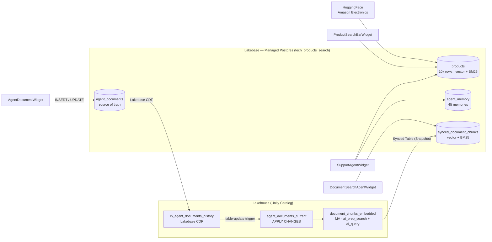

# Lakebase Search — Tech Product Search Demo

A hands-on demo of **[Lakebase](https://docs.databricks.com/lakebase/index.html) Search**: vector, full-text (BM25) and hybrid search running *inside* managed Postgres on Databricks, used by an app-style search bar and by tool-calling AI agents.

It builds one story around a fictional electronics storefront:

1. **Search bar for applications** — 10,000 real Amazon Electronics products (McAuley-Lab/Amazon-Reviews-2023) embedded with `databricks-qwen3-embedding-0-6b` and searched in Lakebase with `lakebase_vector` (cosine `<=>`), `lakebase_text` (BM25) and a hybrid RRF fusion of both.
2. **Agentic retrieval** — a support agent with four Lakebase tools (`search_memory`, `vector_search_products`, `text_search_products`, `hybrid_search_products`) decides which searches to run; every tool call is streamed into the UI.
3. **Agent-edited documents, automatically re-indexed** — an agent writes long documents straight to a Lakebase table. **Lakebase CDF** streams the changes to Delta, a **Lakeflow Spark Declarative Pipeline** chunks + embeds them, and a **Synced Table** pushes the chunks back to Lakebase — no manual re-indexing.
4. **Agent searches over documents** — a second agent runs hybrid search over the synced chunks and opens the full source document when needed.

---

## Architecture



The document pipeline is fully event-driven: a Lakeflow Job (`document-chunking-embedding-trigger`) has a **table-update trigger** on the CDF history table and runs two tasks — `update_chunks` (the SDP pipeline) then `sync_to_lakebase` (refreshes the Snapshot synced table). Snapshot synced tables do not refresh on their own, which is why the job runs the sync explicitly.

---

## Prerequisites

- A Databricks workspace with **Lakebase (Autoscaling)**, **Lakebase Search** (`lakebase_vector`, `lakebase_text` extensions), **Lakebase CDF** and **serverless compute** enabled.
- Foundation Model API endpoints:
  - `databricks-qwen3-embedding-0-6b` (embeddings, dim 1024)
  - `databricks-claude-sonnet-4-5` (agent LLM)
- Permission to create a Lakebase project, a UC schema in your catalog, a Lakeflow pipeline, a job and a synced table.
- Outbound internet access from serverless (to download the product dataset from HuggingFace).
- Notebooks install their own Python deps (`psycopg[binary]`, `huggingface_hub`, `databricks-sdk>=0.118.0`, `anywidget`).

### Configure before running

Edit the **Parameters** cell of `Setup_00` (and the matching cell in `Cleanup_02`). The defaults are environment-specific:

| Variable | Notebook | What to change |
|---|---|---|
| `UC_CATALOG` | `Setup_00`, `Cleanup_02` | Defaults to `main` — change it if you can't create schemas there |
| `UC_SCHEMA` | `Setup_00`, `Cleanup_02` | Optional — defaults to `tech_products_search` |
| `LAKEBASE_PROJECT_ID` / `PROJECT_ID` | `Setup_00`, `Cleanup_02` | Optional — rename if `tech-products-search` is taken |
| `LAKEBASE_DATABASE`, `PG_SCHEMA` | `Setup_00`, `Cleanup_02` | Optional — Postgres database / schema names |
| `EMBEDDING_MODEL`, `LLM_ENDPOINT` | `Setup_00` | Optional — swap in other serving endpoints (embedding dim must stay 1024 or update `EMBEDDING_DIM`) |
| `MAX_PRODUCTS` | `Setup_00` | Optional — fewer products = faster setup |

> Paths are resolved relative to the notebook location (`DEMO_DIR`), so the repo can be cloned anywhere in the workspace — keep `widgets/` next to the notebooks.

---

## Quick start

```text
# 1. Clone this repo into a Databricks Git folder and set the parameters above.

# 2. Run Setup_00 (serverless). The first run is the slow one (download + 10k embeddings):
#    Lakebase project + DB, 10k products + embeddings + indexes, agent_memory,
#    agent_documents + Lakebase CDF, SDP pipeline, synced table, trigger job.
#    Re-runs are idempotent and skip work already done.

# 3. Open Demo_01 and Run all. Cell 2 (%run ./Setup_00) loads helpers and widgets.
```

> **Order matters.** `Setup_00` must complete once before `Demo_01` is used. `Demo_01` re-runs it via `%run` to load helpers/credentials into its own session (fast on re-run).

> **Token lifetime.** Widget callbacks run outside the notebook command context and use a cached Lakebase token (~1h). If widgets start failing with auth errors, re-run cell 2 of `Demo_01`.

---

## Using the demo

`Demo_01` is widget-only — each section is one interactive widget:

| Section | Widget | Shows |
|---|---|---|
| Typical Search Bar for Applications | `ProductSearchBarWidget` | Search-as-you-type over 10k products in Lakebase (vector / text / hybrid) |
| Support Agents Searching over Memories and Products | `SupportAgentWidget` | Tool-calling agent combining customer memory + product search, tool calls streamed live |
| Agent Modifies Documents | `AgentDocumentWidget` | Agent edits a long document in Lakebase; watch CDF -> pipeline -> synced table update the chunks |
| Agent Searches over Documents | `DocumentSearchAgentWidget` | Agent runs hybrid search over `synced_document_chunks` and opens the full document |

> After editing a document, allow a few minutes for the triggered job (CDF -> pipeline -> sync) before the new chunks are searchable.

---

## Repository layout

```
ready_to_git/
├── README.md
├── Setup_00                         # all setup: params, Lakebase helpers, data, CDF, pipeline, synced table, job, widget deps
├── Demo_01                          # widget-only demo notebook (%run ./Setup_00)
├── Cleanup_02                       # teardown of everything Setup_00 creates
└── widgets/                         # anywidget modules imported by Setup_00
    ├── lakebase_search_widgets.py   # ProductSearchBarWidget (+ Vector/Text/Hybrid search widgets)
    ├── support_agent_widget.py      # SupportAgentWidget + TOOL_SPECS
    ├── agent_document_widget.py     # AgentDocumentWidget
    └── document_search_agent_widget.py  # DocumentSearchAgentWidget (reuses support_agent_widget UI)
```

`Setup_00` also **generates** `pipeline_document_chunks` (the SDP SQL source) next to itself on first run — it is a build artifact and is excluded by `.gitignore`.

---

## Cleanup

Run `Cleanup_02` top-to-bottom. Each phase is idempotent:

| Phase | Removes |
|---|---|
| 1 | Lakeflow Job (table-update trigger) |
| 2 | Synced tables |
| 3 | Lakebase CDF config (removed with the project) |
| 4 | SDP pipeline, MV and the generated pipeline notebook |
| 5 | UC schema `UC_CATALOG.UC_SCHEMA` (`CASCADE`) |
| 6 | Lakebase database (all demo tables) |
| 7 | Lakebase project (when `DELETE_PROJECT = True`) |

> `Cleanup_02` drops the **whole** UC schema and Lakebase project configured in its parameters — make sure they are dedicated to this demo and not shared.

---

## How it works (a bit more detail)

- **Auth to Lakebase.** Notebooks mint a short-lived Lakebase credential via the Postgres credentials API and connect with `psycopg` as the current user. The token is cached so widget callbacks keep working outside the command context.
- **Search indexes.** `products` and `synced_document_chunks` get a vector index (cosine) and a BM25 index on the text body. Hybrid search fuses both rankings with Reciprocal Rank Fusion (`RRF_K = 60`).
- **Lakebase CDF.** Configured at the Postgres schema level; `agent_documents` uses `REPLICA IDENTITY FULL` so full row images land in `lb_agent_documents_history` (Delta).
- **Pipeline.** Stage 1 `APPLY CHANGES` (SCD type 1, sequenced by the CDF sort key, handles deletes) rebuilds `agent_documents_current`. Stage 2 MV `document_chunks_embedded` chunks with `ai_prep_search` (~5K chars per chunk) and embeds with `ai_query`.
- **Synced table.** Snapshot mode from the MV into Lakebase `synced_document_chunks`; refreshed by the job's `sync_to_lakebase` task after each pipeline update.
- **No secrets in code.** All auth comes from the notebook identity via the Databricks SDK.
